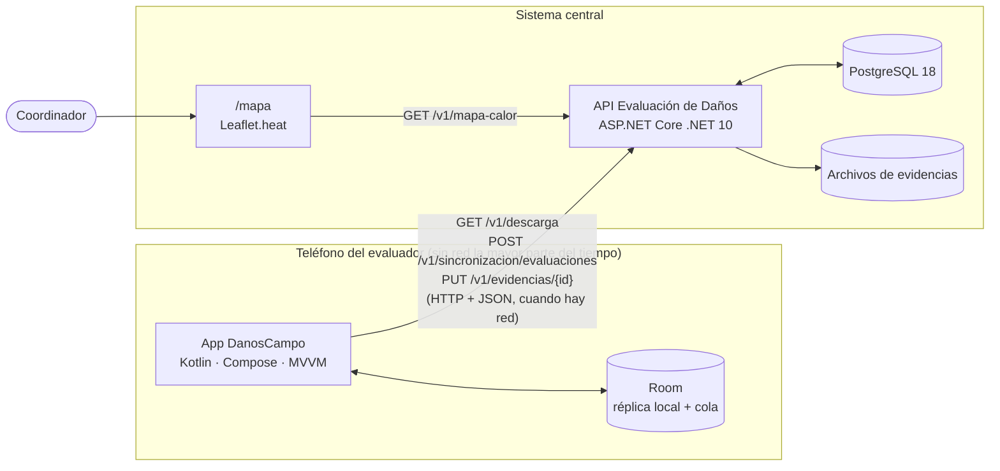
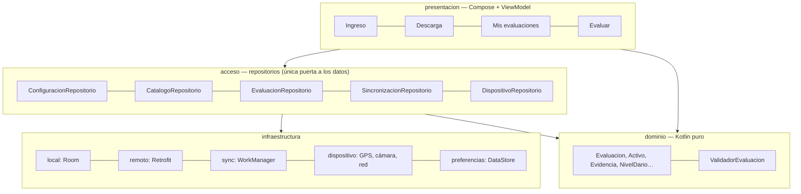
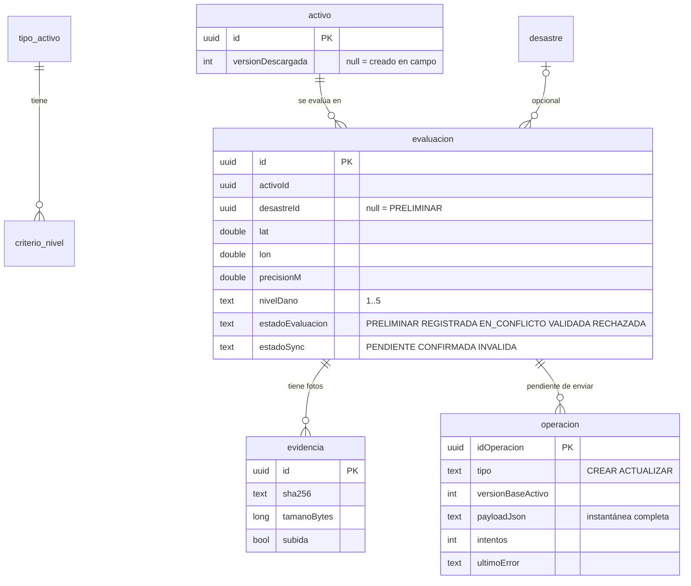
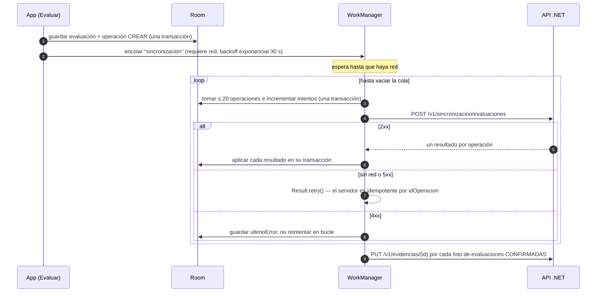

# Diseño — Evaluación de daños en sitios de desastre

## 1. Problema y alcance

Los evaluadores de campo registran la **posición (latitud y longitud)** y el **nivel de afectación (1 a 5)** de los
sitios afectados por un desastre. En terreno casi nunca hay internet, así que la app debe trabajar **desconectada** y
**sincronizar** con el sistema central cuando vuelve la red, sin perder ni duplicar nada. El sistema central muestra un
**mapa de calor** por desastre para ver qué regiones fueron más afectadas.

| Requisito del enunciado | Cómo se cumple |
| --- | --- |
| Recolectar lat/lon | GPS del teléfono (Fused Location, alta precisión) con la precisión en metros; aviso si supera 50 m |
| Nivel de afectación 1–5 | `1 · Sin daño`, `2 · Leve`, `3 · Moderado`, `4 · Grave`, `5 · Destrucción total`, con el criterio de cada nivel según el tipo de activo |
| Funcionar sin internet | Réplica local completa en Room; guardar nunca usa la red |
| Sincronizar al volver la red | WorkManager con restricción de red: envía la cola por lotes y sube las fotos |
| Mapa de calor | Página `/mapa` del API con Leaflet + Leaflet.heat, filtrable por desastre y nivel mínimo |

Requisito de calidad que guía el diseño (**QA-14**): 120 evaluaciones con 5 conflictos → 0 pérdidas, 0 sobrescrituras
silenciosas y 0 duplicados al reenviar.

## 2. Vista general

- **App móvil** (`app/`): cliente *offline-first*. Toda la lectura y escritura del evaluador va contra la base local.
- **API** (`api/`): recibe lotes de operaciones, detecta conflictos y posibles duplicados **sin resolverlos** y sirve el
  mapa de calor.
- **Despliegue de pruebas**: `docker-compose.yml` levanta el API y PostgreSQL.

## 3. App móvil

### 3.1 Capas (MVVM sobre las 4 capas del diseño)

- Cada pantalla tiene un `XxxEstado` (data class) expuesto como `StateFlow` y efectos únicos (navegar, mensajes) por `Channel`.
- Los ViewModel no conocen Room, Retrofit ni WorkManager; Hilt inyecta los repositorios.
- La lista y los contadores son `Flow` desde Room: se actualizan solos cuando la sincronización cambia un estado.

### 3.2 Pantallas

| Pantalla | Qué hace |
| --- | --- |
| Ingreso | Evaluador, organización y URL del API; genera una sola vez el `idDispositivo` (UUID) |
| Descarga | Baja tipos de activo con sus criterios, desastres y activos registrados. Si falla, conserva lo anterior |
| Mis evaluaciones | Tarjetas con tipo, nivel, activo, fecha, estado de la evaluación y de sincronización y fotos pendientes; indicador de red, contador de pendientes y botón Sincronizar |
| Evaluar | Activo descargado o nuevo, GPS, tipo, nivel 1–5 con su criterio, desastre opcional, descripción y fotos |

### 3.3 Modelo de datos local (Room)

La tabla `operacion` es la **cola de salida**. Cada operación guarda la instantánea completa de la evaluación
(`payloadJson`) en el momento de encolarla.

### 3.4 Invariantes de la cola

1. Una operación **solo sale de la cola** cuando el servidor respondió por ella.
2. Una operación ya intentada (`intentos > 0`) es **inmutable**. Editar antes del primer envío reemplaza su payload;
   editar después crea una operación `ACTUALIZAR` nueva.
3. La app **nunca resuelve conflictos**: refleja lo que decide el servidor.
4. Ni la sincronización ni la descarga borran evaluaciones o fotos. La descarga tampoco toca activos creados en campo,
   activos con operaciones pendientes ni activos que use una evaluación local.

Guardar (evaluación + fotos + activo nuevo + operación) es una sola transacción de Room.

### 3.5 Sincronización

| Resultado del servidor | Efecto en la app |
| --- | --- |
| `APLICADA` | Sale de la cola; `CONFIRMADA`; estado que dice el servidor; nueva versión del activo |
| `EN_CONFLICTO` / `POSIBLE_DUPLICADO` | Sale de la cola; `CONFIRMADA`; evaluación `EN_CONFLICTO` para revisión humana |
| `INVALIDA` | Sale de la cola; `INVALIDA` con el motivo visible. Al corregirla se encola de nuevo |
| Sin resultado | Se queda en la cola y se reintenta más tarde |

Si la evaluación se editó mientras viajaba la operación anterior, sigue en `PENDIENTE` hasta que responda la nueva.

### 3.6 Fotos de evidencia

Cámara del sistema (`TakePicture`) hacia `filesDir/evidencias/{uuid}.jpg` vía FileProvider. Al volver: corrige la
orientación EXIF, escala a 1600 px de lado mayor, JPEG calidad 80, y calcula SHA-256 y tamaño del archivo final. El
servidor verifica el hash al recibir la foto.

## 4. Sistema central (API)

### 4.1 Contrato REST

Encabezados obligatorios en `/v1/*`: `X-Usuario`, `X-Organizacion`, `X-Dispositivo`, en UTF-8 para admitir tildes.

| Método y ruta | Uso |
| --- | --- |
| `GET /v1/descarga?desastreId=` | Catálogo, desastres y activos con su versión |
| `POST /v1/sincronizacion/evaluaciones` | Lote de operaciones → un resultado por operación, en orden |
| `PUT /v1/evidencias/{id}` | Foto (multipart `archivo`); 422 si el hash no coincide |
| `GET /v1/mapa-calor?desastreId=&nivelMinimo=` | Puntos del mapa de calor |
| `GET /v1/conflictos`, `GET /v1/evaluaciones` | Revisión |
| `GET /mapa` | Página del mapa de calor |

### 4.2 Reglas de negocio

- **Idempotencia**: cada operación procesada se guarda con su resultado (`operacion_procesada`); reenviarla devuelve
  exactamente lo mismo sin crear nada.
- **Conflicto de versión**: hay conflicto si el activo tiene una versión posterior a la base que traía la operación y
  la produjo **otro** dispositivo. Las versiones del mismo dispositivo no cuentan, así que crear y editar sin red no
  choca consigo mismo. En conflicto no se toca la evaluación vigente: se guardan ambas versiones.
- **Posible duplicado**: un activo nuevo a ≤ 25 m (Haversine) y ±24 h de otra evaluación; se marca para revisión.
- **Una transacción por operación**: el error de una no tumba las demás. Si una falla de forma inesperada, el lote
  responde 503 y la app lo reenvía.

### 4.3 Mapa de calor

Un punto por activo con el nivel de su evaluación vigente en el desastre elegido. El peso crece con el nivel: 1 → 0,
2 → 0,25, 3 → 0,5, 4 → 0,75, 5 → 1. La página usa Leaflet 1.9.4 + Leaflet.heat sobre OpenStreetMap, muestra el
conteo por nivel y los conflictos pendientes, y se refresca cada 10 s. Solo aparecen las evaluaciones asociadas a un
desastre: las preliminares (sin desastre) no se pintan.

## 5. Decisiones principales

| Decisión | Motivo |
| --- | --- |
| Cola de operaciones inmutables con instantánea completa | Reenviar es seguro; nada se pierde si se cae la red a mitad de un envío |
| UUID generados en el teléfono | Crear sin red sin colisiones; el servidor deduplica por `idOperacion` |
| El servidor detecta conflictos; la app no los resuelve | Ninguna edición sobrescribe en silencio la de otro evaluador (QA-14) |
| Corregir una `INVALIDA` que el servidor nunca registró reenvía `CREAR` | El servidor rechaza `ACTUALIZAR` sobre una evaluación que no existe |
| Validaciones de longitud iguales a las del servidor | El error se ve en el formulario y no vuelve como `INVALIDA` |
| Fotos aparte del lote, después de confirmar | El lote es liviano; la subida es idempotente y verificada por hash |
| HTTP sin TLS solo en debug | Simplificación para pruebas en red local |

## 6. Tecnologías

| Componente | Tecnología |
| --- | --- |
| App | Kotlin, Jetpack Compose (Material 3), MVVM, Hilt, Room, WorkManager, Retrofit + kotlinx.serialization, OkHttp, DataStore, Fused Location, Coil; minSdk 26 |
| API | ASP.NET Core .NET 10, EF Core 10 + Npgsql, Razor Pages |
| Base central | PostgreSQL 18 |
| Mapa | Leaflet 1.9.4 + Leaflet.heat 0.2.0, OpenStreetMap |
| Despliegue de pruebas | Docker Compose |

## 7. Pruebas

| Nivel | Qué cubre |
| --- | --- |
| Unitarias app (JUnit + coroutines-test) | Validador, reglas de la cola, los 4 resultados y "sin resultado", errores de red/5xx/4xx, serialización del contrato, encabezados con tildes y un escenario QA-14 (120 evaluaciones, 5 conflictos, una respuesta perdida) |
| Instrumentadas app (Room en memoria) | Guardado atómico, operaciones sin respuesta que no se borran, descarga que no borra datos de campo |
| Contrato app ↔ API real | Descarga, activo nuevo con foto, edición, conflicto entre dos dispositivos e `INVALIDA` corregida |
| API (xUnit + WebApplicationFactory) | Regla de conflicto, duplicados, sincronización, evidencias y mapa (`dotnet test` en `api/`) |
