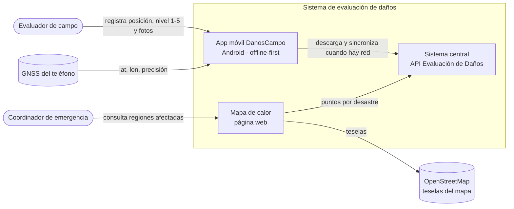
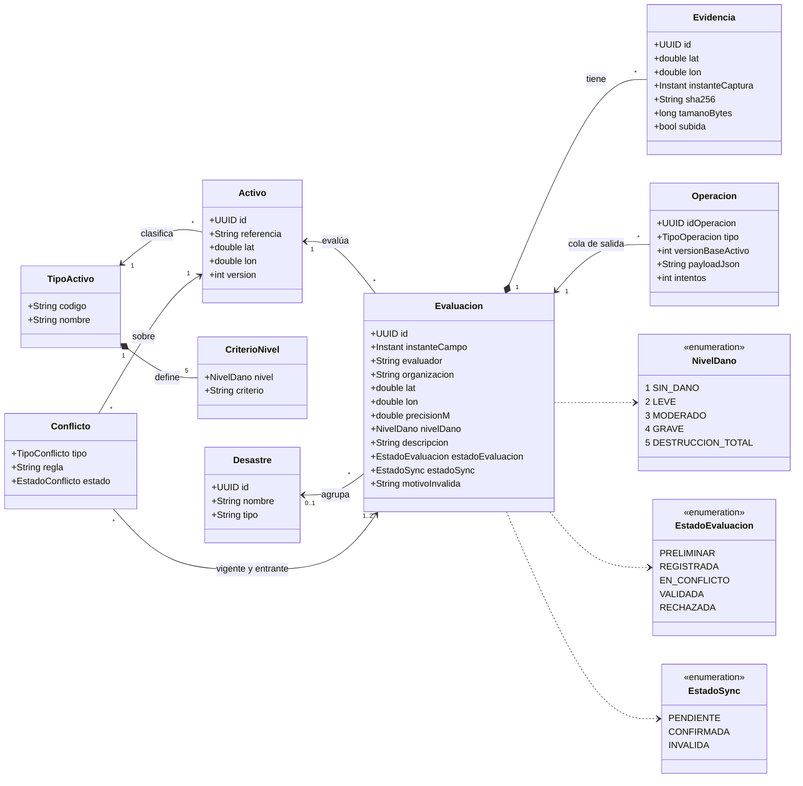
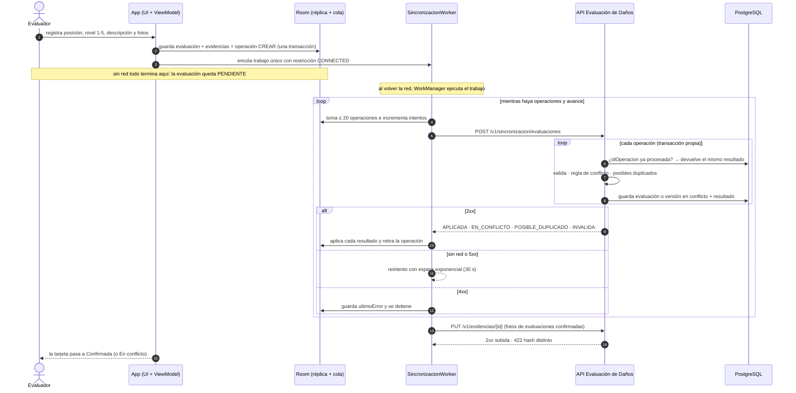
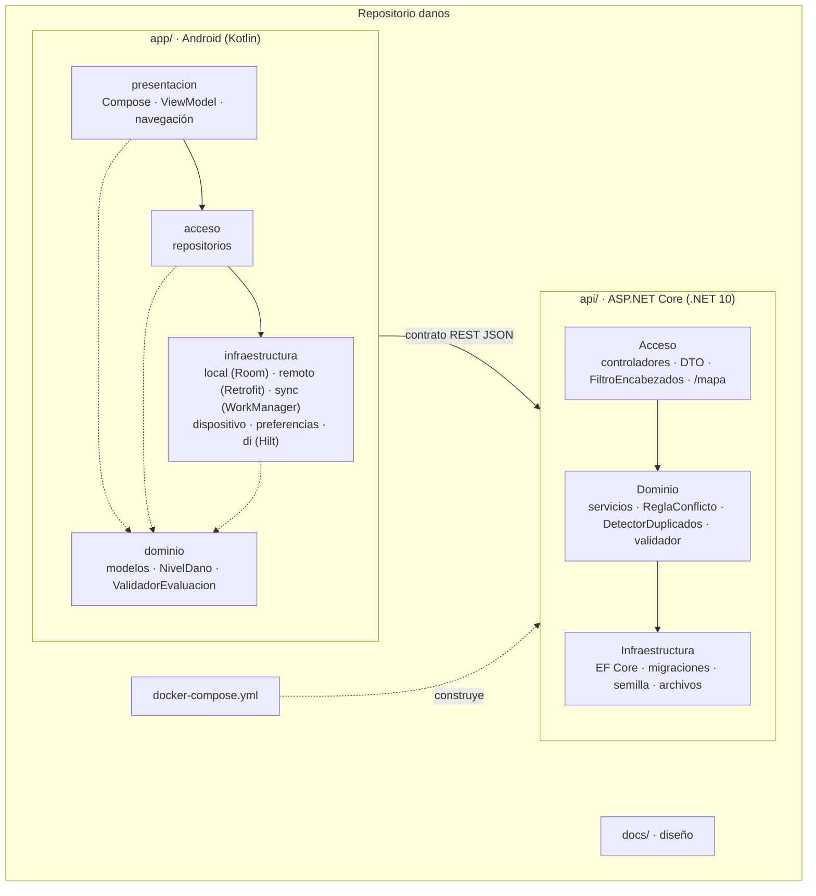
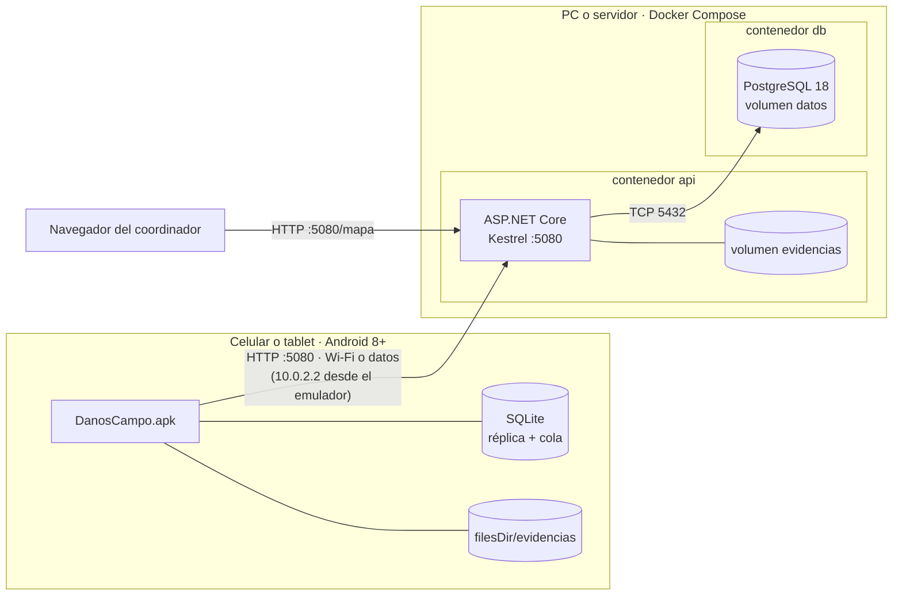
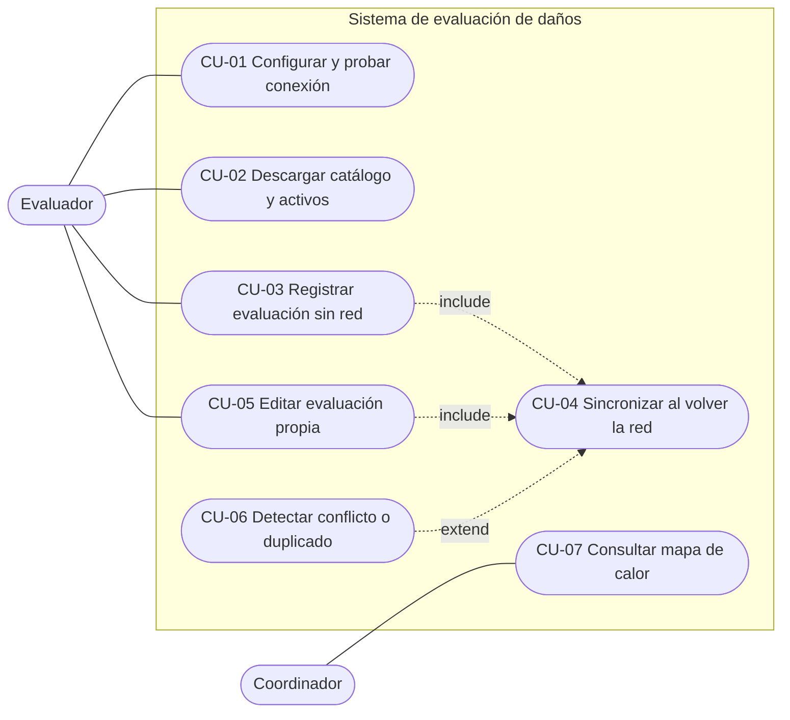

# Documento de diseño — Evaluación de daños en sitios de desastre

Carlos Daniel Guiza, Juan Felipe Rubiano, Samuel Gantiva · Noviembre de 2026

Versión en PDF: [DISENO.pdf](DISENO.pdf). Fuente LaTeX: [latex/](latex/).

## 1. Descripción general

El sistema permite registrar la posición (latitud y longitud) y el nivel de afectación (de 1 a 5) de
sitios afectados por un desastre. Tiene tres partes:

- Una app Android que funciona sin internet y guarda todo en el teléfono.
- Un sistema central (API en .NET con PostgreSQL) que recibe la información cuando vuelve la red.
- Una página con un mapa de calor que muestra las zonas más afectadas de cada desastre.

Lo más importante del diseño es que no se pierda ni se sobrescriba información al sincronizar, aunque
varios evaluadores trabajen sin red sobre el mismo sitio. Para eso la app guarda una cola de operaciones y
el servidor detecta los conflictos sin resolverlos.

El diseño se describe con el modelo de vistas 4+1 de Kruchten, más un diagrama de contexto.

## 2. Diagrama de contexto

El evaluador usa la app en campo y la app toma la posición del GPS del teléfono. Cuando hay red, la app
descarga el catálogo y sincroniza con el sistema central. El coordinador ve el mapa de calor desde un
navegador; el mapa base sale de OpenStreetMap.

## 3. Vista lógica

- **Evaluación**: lo que registra el evaluador sobre un activo (posición, precisión, nivel, descripción y
  fotos). Su id es un UUID generado en el teléfono.
- **Activo**: el sitio o bien evaluado (vivienda, escuela, puente, etc.). Tiene una versión que aumenta
  cada vez que el servidor acepta una evaluación sobre él.
- **TipoActivo** y **CriterioNivel**: catálogo que se descarga; cada tipo describe qué significa cada nivel
  de 1 a 5.
- **Desastre**: agrupa evaluaciones. Si una evaluación no tiene desastre queda como preliminar y no sale en
  el mapa de calor.
- **Evidencia**: foto con su ubicación, fecha y hash SHA-256.
- **Operación**: elemento de la cola de envío (crear o actualizar) con una copia completa de la evaluación.
- **Conflicto**: lo crea el servidor cuando una evaluación choca con otra.

Cada evaluación tiene dos estados. El estado de sincronización es solo local: `PENDIENTE` mientras no hay
respuesta del servidor, `CONFIRMADA` cuando el servidor la recibió e `INVALIDA` si la rechazó. El estado de
la evaluación lo decide el servidor: `PRELIMINAR`, `REGISTRADA`, `EN_CONFLICTO`, `VALIDADA` o `RECHAZADA`.

**Reglas**

- Una operación solo se borra de la cola cuando el servidor respondió por ella.
- Una operación que ya se intentó enviar no se modifica. Si el usuario edita después, se crea una operación
  nueva.
- La app nunca resuelve conflictos, solo muestra lo que dice el servidor.

**Conflicto.** Cada operación lleva la versión del activo que tenía el teléfono. Hay conflicto si el activo
tiene una versión mayor hecha por otro dispositivo; las versiones del mismo dispositivo no cuentan. Cuando
hay conflicto el servidor guarda las dos versiones y no cambia la vigente.

**Duplicados.** Un activo nuevo se marca como posible duplicado si hay otra evaluación a menos de 25 m
(distancia de Haversine) en un rango de 24 horas.

**Mapa de calor.** Se toma un punto por activo con el nivel de su evaluación vigente. El peso es 0, 0,25,
0,5, 0,75 y 1 para los niveles 1 a 5.

## 4. Vista de procesos

1. Al guardar, la app escribe en una sola transacción la evaluación, las fotos y una operación en la cola,
   y programa un trabajo de WorkManager que solo se ejecuta cuando hay red. Sin red el proceso termina ahí
   y la evaluación queda pendiente.
2. Cuando vuelve la red, el trabajo toma hasta 20 operaciones y las envía en un lote.
3. El servidor procesa cada operación en su propia transacción. Si ya había recibido esa operación (mismo
   `idOperacion`) devuelve la misma respuesta, así que reenviar no duplica nada.
4. La app aplica cada resultado: `APLICADA` confirma la evaluación, `EN_CONFLICTO` y `POSIBLE_DUPLICADO`
   la confirman pero la marcan en conflicto, e `INVALIDA` muestra el motivo para que el usuario la corrija.
5. Al final se suben las fotos de las evaluaciones confirmadas.

Si no hay red o el servidor responde con error 5xx, el trabajo se reintenta más tarde con espera
exponencial. Si responde con error 4xx, se guarda el error y no se reintenta en bucle.

## 5. Vista de desarrollo

El repositorio tiene dos proyectos: la app y el API. Los dos están organizados por capas y solo se
comunican por el contrato REST.

**App (Kotlin).** `presentacion` tiene las pantallas en Jetpack Compose y los ViewModel; `acceso` tiene los
repositorios, que son la única forma de llegar a los datos; `dominio` tiene los modelos y validaciones sin
dependencias de Android; `infraestructura` tiene Room, Retrofit, WorkManager, GPS y cámara. Las
dependencias se inyectan con Hilt.

**API (.NET 10).** `Acceso` tiene los controladores y la página del mapa; `Dominio` tiene los servicios y
las reglas de conflicto y duplicados; `Infraestructura` tiene Entity Framework Core y el almacenamiento de
fotos.

| Endpoint | Uso |
| --- | --- |
| `GET /v1/descarga` | Catálogo, desastres y activos |
| `POST /v1/sincronizacion/evaluaciones` | Recibe un lote de operaciones |
| `PUT /v1/evidencias/{id}` | Recibe una foto |
| `GET /v1/mapa-calor` | Puntos del mapa de calor |
| `GET /mapa` | Página del mapa de calor |

## 6. Vista física

La app corre en el celular o tablet y guarda sus datos en SQLite. El sistema central corre con Docker
Compose en dos contenedores: uno con el API (puerto 5080) y otro con PostgreSQL. El coordinador abre el
mapa desde el navegador. Desde el emulador de Android el servidor se ve en `10.0.2.2:5080`; desde un
celular se usa la IP del PC en la misma red Wi-Fi.

## 7. Escenarios

- **CU-01 Configurar**: el evaluador escribe su nombre, organización y la URL del servidor, y puede probar
  la conexión.
- **CU-02 Descargar**: con red, descarga tipos de activo, desastres y activos.
- **CU-03 Registrar sin red**: elige o crea el activo, la app toma el GPS, elige el nivel de 1 a 5, el
  desastre, una descripción y fotos, y guarda.
- **CU-04 Sincronizar**: al volver la red las evaluaciones se envían solas.
- **CU-05 Editar**: modifica una evaluación propia y se vuelve a sincronizar.
- **CU-06 Detectar conflicto**: el servidor detecta conflictos o duplicados y guarda ambas versiones.
- **CU-07 Ver mapa de calor**: el coordinador elige un desastre y ve las zonas más afectadas.

El escenario CU-03 + CU-04 recorre todas las vistas: usa las clases Evaluación y Operación (lógica), el
trabajo de WorkManager y el servidor (procesos), las capas de la app y del API (desarrollo) y los dos nodos
(física).

## 8. Decisiones de diseño

- Se guarda una copia completa de los datos en el teléfono para poder trabajar sin internet.
- Los ids se generan en el teléfono (UUID) para poder crear registros sin red.
- El servidor detecta los conflictos y no los resuelve, para no perder la versión de nadie.
- El conflicto se decide por la versión del activo y no por la hora del teléfono, porque los relojes de los
  celulares pueden estar mal.
- Las fotos se suben aparte del lote para que el envío sea liviano.
- El sistema central se despliega con Docker Compose para levantarlo con un solo comando.
